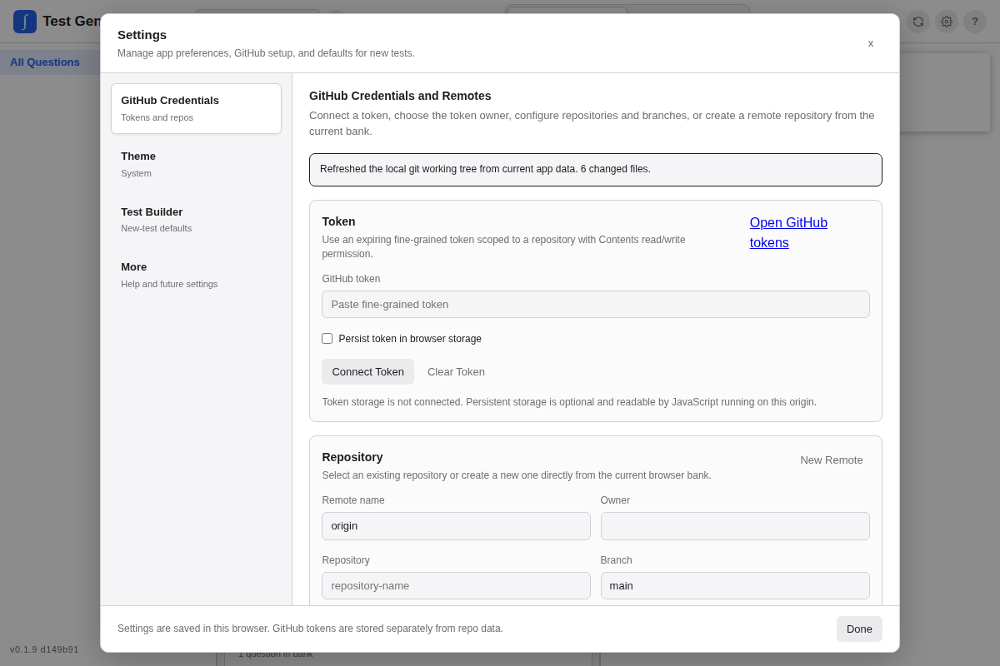

The Gradebook tab is an experimental roster and score-entry area for tests built in the app. Enable it under **Settings -> More -> Gradebook (experimental)**.

Gradebook course sections are rostered groups of students such as “Period 2 AP Calc”. They are separate from curriculum classes in the question bank. Classes are available across banks, and **New class** creates one without requiring questions or saved tests.

## Course Sections and Rosters

Create a course section with:

- Section name
- Optional course (linked curriculum class)
- Optional term label
- Category weights

Use **Edit section** beside the section name to change its name, term, and linked course. Custom course names can also be changed here; renaming a course updates its label for every linked section. Built-in curriculum course labels remain fixed.

Drag sections in the left pane to rearrange them. The up/down buttons or **Alt+↑ / Alt+↓** provide keyboard controls. The order is saved and retained in backups.

Students have stable generated IDs, optional SIS IDs, first and last names, an optional **Known by** name (the name they go by, such as Kate for Katherine), optional email addresses, and active/inactive status. The Gradebook shows students by their known-by name, falling back to their first name.

Overview puts the **Grade overview** grid directly below its filters. Use **Points / Percentage** beside the grid to choose how assessment scores appear. Click **Student**, an assessment heading, or **Total** to sort; click again to reverse the order. Ungraded scores stay at the bottom when sorting by grades. Select a name in the grid to edit details or active status.

Overview's right pane is **Section tools**. Expand **Assessments** to add saved tests or external assessments and review or edit existing assessments; expand **Category weights** to adjust weights or Missing grades policy. **Roster** contains **Add Students** and **Import Roster**, and **Section management** contains archive and Trash actions. These sections start collapsed, remember their open/closed state on this device, and keep unfinished form input when collapsed. **Follow up** shows student counts across all assessments and the full roster; select **Missing work** or **Ungraded work** to apply that Overview filter.

**Section tools** beside the view tabs opens or focuses this pane, including when it has been hidden. On tablet and phone widths, **Section tools**, **Assessments**, or **Student details** opens the relevant pane as a drawer. Close it with **Close details**, Escape, or the backdrop. Adding an assessment opens Grading and closes the drawer, ready for score entry. A section without students or assessments also provides **Add students** and **Add assessment** shortcuts beside the grid.

Choose **First Last** or **Last, First** under **Settings -> More -> Student names**.

Names are saved exactly as typed in Student view, so casing like McKenna or DeSouza can be fixed by hand. Ending an enrollment or marking a student inactive keeps existing scores.

Use the left pane to select sections. To put a section away, expand **Section management** in **Overview**’s right pane:

- **Archive section** keeps a finished section, with its roster and scores, out of the active list. Restore it from **Archived** in the left pane at any time.
- **Move to Trash** is for a section you mean to delete. It can be restored from **Trash** in the left pane until you choose **Delete** there, which removes its roster entries, assessments and scores for good. Students enrolled in other sections keep those records.

## Roster Import

The **Add Students** panel can import PowerSchool-style exports from CSV, TSV, or plain text. The importer recognizes common columns such as:

- Student Number
- Student ID
- First Name
- Last Name
- LastFirst
- Student Name
- Email
- Expression / Period / Section
- Term

- Known By / Preferred Name / Nickname

Names that arrive in ALL CAPS or all lowercase are converted to proper caps (`MCKENNA` becomes `Mckenna`, `o'brien` becomes `O'Brien`). Names that already mix upper and lower case are kept as they are. If you fix a name's casing by hand, re-importing the roster keeps your version.

Imports happen in the browser. Selecting a file opens a preview of students to add or update. Cancel leaves the roster unchanged. Student IDs that conflict with another student, conflicting IDs for the same student, and ambiguous name matches are flagged and skipped; correct those rows before reimporting. Confirm **Import students** to merge the remaining rows. Matching SIS IDs, emails, legal names, or known-by names update existing students and enroll them in the selected section instead of creating duplicates. New IDs and email addresses merge into the existing record; blank imported fields keep existing information. ID columns can be named **ID**, **Student ID**, **Student IDs**, **Student #**, or **Student Number**, and leading zeros are preserved.

## Assessment Snapshots

Open **Section tools → Assessments** in Overview to add or review assessments. A section linked to a course defaults to showing saved tests from that course. Check **Show tests from all courses** to choose another course's test or an unclassified test. Saved tests from other banks are available too. Change a section's course from the dropdown under its name. A section with no course shows all saved tests. **Add to Gradebook** in Build can add a test to any active section, listing matching courses first.

A saved test is a reusable template. A Gradebook assessment is an administered instance.

When a saved test is added to the Gradebook, the app freezes:

- Saved test ID and name
- Test title and subtitle
- Selected question IDs and order
- Question labels
- Point values at that moment
- Base total points
- Bonus points
- Question-level bonus flags
- Test type/category
- Administered date

This keeps old grades from changing when a saved test is edited or a question’s point value changes later.

### External Assessments

For a test, lab, or assignment not made in TestGen, open **Add an external assessment** in the Assessments panel and enter:

- Name
- Category (Quiz, Test, Assignment, and so on), which sets its weighting
- **Out of**, the total marks
- Optional **Question marks**, such as `2, 2, 3, 5`, to grade it question by question. The total is then the sum of the marks.

It uses the date beside **Add to Gradebook**. Without question marks it is graded as a total only. External assessments are labelled "External" in the list and count toward totals like any other assessment. They are not limited by the section's course.

### Editing and Removing Assessments

Use the visible **Type** and **Date** fields on an assessment in Overview or at the top of Grading to change its category or administered date. These changes save immediately. Assessments appear chronologically, oldest first, in the lists and Overview columns; changing a date moves the assessment into its new position.

In Grading, **Edit** also lets you change the assessment name and other details.

For external assessments you can also fix **Out of** or the **Question marks**:

- Removing a question that already has scores asks first. It then deletes those question scores and re-adds each student's total from the questions that remain.
- Clearing all question marks turns the assessment into Total only. Each student's total is kept and only the question detail is deleted.

Question marks on saved-test assessments stay frozen, so past grades don't change unless you change one yourself (below).

### Changing What a Question Is Out Of

In the Grading view, click a question's heading (for example **Q3 / 4**) to change what it is out of. Use **0** to leave a question out of the total, for example when the class skipped it because of a typo, or a smaller number when only part of it counts.

- If some students already scored above the new value, **Lower … scores** (on by default) brings those scores down to it and re-adds their totals. Untick it to keep their scores.
- For an assessment from a saved test, choose **Gradebook only** to change just this assessment, or **Gradebook and test** to also change the question's value in the saved test, so a reprint matches. The saved test gets its own copy of the question; the bank is not changed.
- An external assessment has no saved test, so it just has **Save**.

**Remove from Gradebook**, in the same panel, deletes the assessment and all of its recorded scores after confirmation. This cannot be undone, so take a JSON backup first if you might need the scores.

Editing a saved test's Quiz/Test/Assignment/Exam/Formative/Worksheet type updates matching Gradebook assessment categories because that type controls section weighting. It does not create a new question snapshot or change point values.

## Missing Grades

In Overview’s **Category Weights** panel, **Missing grades** controls whether Missing counts as zero or is excluded from totals. The default is **Exclude from totals**, including for existing sections. This setting applies to final grades, category summaries, sorting, class statistics, and exported final grades. Ungraded, Excused, Absent, and Incomplete remain excluded; assessment cells still identify their score state.

## Dropping Lowest Scores

In Overview, open **Section tools → Category weights & drops → Drop lowest scores**. Enter how many scores to drop in each category, such as **Quiz: 1** or **Assignment: 2**. Zero keeps every eligible score in that category. The policy belongs to this course section and applies separately to each enrolled student, including inactive students.

The policy ranks eligible assessment **percentages**, using each student's denominator for alternative assessments. It drops up to the requested number while keeping at least one counted score in each category. For example, dropping one of `4/10`, `30/100`, and `9/10` excludes `30/100`; the remaining category total is `13/20`. Assessment dates, then creation order and IDs, break percentage ties consistently. As more grades arrive or marks change, the drop selections update automatically.

Missing grades are eligible when the section counts them as zero. Ungraded, Excused, Absent, Incomplete, zero-denominator assessments, and unfinished alternative scores remain excluded and do not consume a drop. Bonus marks retain their percentages above 100%.

Changes show an **Unsaved preview** with affected-student counts and a student-by-student grade comparison and proposed exclusions. Choose **Save drop policy** to apply the policy. An unfinished policy draft stays in this browser until saved or cancelled, including after hiding the pane or reloading. If the policy changes elsewhere, your draft stays available until you reload the current policy.

**Dropped** labels identify exclusions in Overview, Grading, Student view, printed reports, and Overview CSV. Recorded marks, question scores, and score states remain intact and editable. Category totals, final grades, final-grade class statistics, grade-based filters, and exported final grades use the retained scores. Per-assessment class statistics continue to describe recorded marks. A dropped Missing mark remains Missing for follow-up filters and missing-work reports, with its dropped status identified.

Use **Turn off all drops**, then save, to count every otherwise eligible score again. **Restore previous policy** switches between the last two saved configurations, including an all-zero policy. The current policy and previous configuration are included in Gradebook JSON backups and workspace section records. **Scores CSV** preserves raw marks and adds a `droppedByPolicy` column. Policies do not alter bank questions, saved tests, or administered question snapshots; reports already opened keep their existing snapshot until reopened.

## Score Entry

The overview score grid shows students by assessment. Its bottom **Average (mean)** row summarizes recorded scores for active students. Click any summary cell to cycle through mean, median, minimum, and maximum. Assessment summaries follow **Points / Percentage**; the final-grade summary always shows a percentage. Ungraded and nonnumeric score states are excluded, except Missing when the section counts it as zero. Selecting an assessment opens the full **Grading** view.

The right pane lists every assessment. Select one to start grading; select it again to expand its question snapshots. Use **Totals — Points / Percent / Both** beside the grading controls to show totals as `10/20`, `50%`, or `10/20 – 50%`. This choice is remembered on this device and updates while scores are entered.

Overview displays the entire roster in the main page, with one scroll area instead of a separate scrolling grid. The Overview and Grading grids keep their column headings at the top and student names and totals frozen on the left as you scroll. In Grading, the active row and column are highlighted. Keyboard navigation instantly reveals the entire selected cell and the next question when space permits; scrolling is never animated.

The Grading view supports spreadsheet-style per-question score entry:

**Undo / Redo** and Ctrl/Cmd+Z (Ctrl/Cmd+Shift+Z to redo) restore score edits, including score states. Typing within one cell is one edit, and a pasted block is one edit. History lasts for the current browser session and resets after roster, section, or assessment changes and backup restoration.

Paste a tab-separated column or rectangular block from Excel or Google Sheets into a score cell. The starting cell determines the destination, using the displayed student order. Blank cells clear scores; numeric values are point scores, even when Overview displays percentages. Total-entry columns also accept Missing, Excused, Absent, and Incomplete. Invalid values or blocks that exceed the grid are rejected before any score changes.

Keyboard navigation:

- Type directly into cells.
- Arrow keys move to adjacent cells. Enter moves down (Shift+Enter up) and Tab moves right (Shift+Tab left). Tab past a student's last question continues on the next student's first question, and wraps around the grid.
- Cell contents are selected for quick replacement.
- Type letters to jump to a student. Typing `ja` highlights the first student whose name starts with "Ja" and moves to their first question, ready for grades. Entering a grade or pressing Escape ends the search.
- **Sort: First / Last** orders students by known-by name or last name.
- Score entry saves automatically a moment after you stop typing.
- Decimal scores can start with `.`, such as `.5`.
- Question scores are tallied into the assessment-level score.

### By Question or Total Only

Each assessment records scores either **By question** (one cell per question, tallied into a total) or **Total only** (one score per student). Switch with **Entry** in the Grading header. Keyboard movement, Tab cycling, and type-to-find work the same way in both.

New assessments use the default under **Settings -> More -> New assessments**. Switching an assessment keeps every recorded score:

- Question scores are already summed into totals, so Total only shows them straight away.
- Typing a total that differs from a student's question scores replaces those question scores.
- Switching back to By question warns if some students only have totals. Their total stays until you enter a question score for them.

### Alternative Assessments

Choose **Alternative** in a student's State dropdown when they wrote a different quiz, test, or assignment. Enter their final earned marks and their **out of** value in the Total column, for example `18 / 20`. The denominator must be greater than zero.

This student always uses direct total entry, even when the assessment is set to **By question**. Their question cells are disabled. Their alternative score and denominator determine their percentage, category totals, and final grade. Other students continue using the original assessment. Alternative scores are identified in Overview and Student view and included in JSON backups and CSV exports. Both the score and denominator support Undo / Redo.

## Student View

The **Student** tab opens with nobody selected and focuses **Find a student**, ready to type. Its fuzzy search matches legal and preferred names, partial names, accents, small typos, and student IDs across active sections. Use **↑ / ↓** to highlight a result and **Enter** to select it. Matches in another section show the class name in parentheses; selecting one opens that student's section. Clicking a name or total in Overview opens that student directly.

Student view keeps the student's roster details and notes in the main area. Its right pane contains a collapsible **Grade breakdown** with category totals and weights, plus **Assessments** grouped by category. Assessment rows still expand to show that student's question scores. **Grades & assessments** beside the view tabs opens the pane when hidden or on smaller screens. These disclosure choices are remembered on this device.

Student view shows:

- Final grade
- Category totals such as Quiz and Test, showing only categories with assessments in the selected section
- Assessments grouped under their categories
- Expandable per-assessment question scores for that student only
- Editable local roster details
- Active/inactive enrollment controls
- **Archive in Section** ends only this enrollment and keeps scores.
- **Remove from this section** deletes only this enrollment and its scores.
- **Active across all sections** changes the student's overall status.
- **Delete from all sections** deletes the student and every enrollment and score after confirmation.

Clicking an assessment in Student view expands that student's per-question details in place. It does not navigate to the Grading view, so other students' scores are not exposed.

## Finding Students with Saved Filters

**Overview filter**, above the score grid, offers **Students with missing work**, **Course grade below 50%**, and **Students with ungraded work**. **All students and assessments** or **Clear filters** restores the full view.

Open **Adjust and save filters** to combine a student name or ID, an assessment category, a work state, and a course-grade cutoff. Work-state conditions look for at least one matching assessment in the chosen category. The cutoff always uses the student's full course grade and the section's Missing grades policy; students with no calculated grade do not count as failing. **Missing**, **Incomplete**, and **Ungraded** are separate states.

Enter a **Filter name**, then **Save as new filter**. Saved filters belong to the selected course section and appear in the filter menu. After adjusting one, use **Update saved filter** or save another named filter. **Undo filter update** switches back to the previous saved version. **Move filter to Trash** keeps the current view and makes the saved filter restorable under **Filters in Trash**.

The filtered roster, assessment columns, summary statistics, Overview CSV export, and batch report recipients agree. The current filter is remembered in this browser for each section. The Grading view keeps the full roster so entering a missing mark does not make a row disappear while you type. Student search continues to find students across sections.

## Student Notes

Open a student, then write a **New note** under **Student notes** and choose **Save note**. Notes belong to that student in the current course section. **For reports** explicitly allows a note to appear on printed student reports; other notes remain teacher-only.

An unfinished note draft is recovered in this browser when you return to that student or reload. Save it to the Gradebook to include it in a Gradebook JSON backup or workspace folder sync. The draft message and saved-note message distinguish these states.

Use **Edit note** and **Save note changes** to revise a saved note. **Undo last edit** switches between its last two saved versions, including its For reports setting. **Move note to Trash** keeps it out of reports; **Notes in Trash → Restore note** brings it back, even after reloading. Notes and their recovery versions travel in Gradebook backups and workspace sync.

If a note changes on another computer while you are editing it, saving preserves your draft and reports the conflict. Use **Save as new note** to keep your version alongside the newer one. A failed browser save preserves input and does not add an apparently saved note.

Archiving a student or section retains notes. Permanently deleting a student, enrollment, or section deletes the notes within that scope, as described by its confirmation. Deleting a section also removes that section's saved filters.

## Printing Progress and Missing-Work Reports

Choose **Print student reports** beside the view tabs to report on the current Overview roster and assessment columns. In Student view, **Print this student's report** uses that student and all assessments in the section. The report dialog names the section, student selection, and assessment scope.

- **Progress report** includes assessment results, score states, category totals, and the current course grade.
- **Missing-work report** lists work explicitly marked Missing. **Include Incomplete** and **Include Ungraded** are optional; blank grades are not automatically missing or overdue. Students without matching work are omitted.
- **Include notes marked For reports** controls the explicitly shareable notes. Teacher-only notes, previous note versions, and notes in Trash never appear.
- Batch reports omit inactive students unless **Include inactive students** is selected. A report requested for an individual inactive student includes that student's record and labels it inactive.

Use **Preview student** to review each report. Course and category totals always use all assessments in the section, even when the assignment list is filtered. Reports follow the existing category weights, Missing grades policy, bonus marks, and student-specific alternative denominators. A report is a snapshot of the recorded data when the dialog opens; close and reopen it to refresh.

**Print report(s)** opens the browser's print dialog, where you can print or choose **Save as PDF**. Each student's report starts on a new page; long reports may continue onto more pages. **Download HTML** saves the same reports as a standalone printable document. Report generation does not change scores or assessment snapshots.

## Score States and Totals

Score states include:

- Score
- Alternative (direct score with an individual denominator)
- Missing
- Excused
- Absent
- Incomplete

Category percentages use the sum of earned marks divided by the sum of possible marks for graded assessments. Finals apply the section's category weights to those same percentages; categories without graded scores are left out and the remaining weights are scaled proportionally.

Normal numeric scores and completed alternative scores count toward totals unless excluded by a drop policy. Missing also counts as zero when enabled for the section. Bonus question points can raise earned points above the base denominator. Retakes, late penalties, curves, and standards-based reporting are left for later phases.

## Data Sensitivity

Gradebook data is stored in this browser under `tg-gradebook-v1` and shared across question banks. A connected workspace keeps it in `gradebook/records/`, as small files that stay in step with the folder automatically, so a workspace folder synced between computers (for example with Google Drive) carries the Gradebook between them. See [Gradebook in the folder](./local-workspace.md#gradebook-in-the-folder). It is not projected into GitHub repo sync or the app's Google Drive backup.

Existing browser bank gradebooks migrate into the shared gradebook once, matching records by their stable IDs and keeping the newest copy. Original bank copies remain available for recovery. Connected workspaces keep their existing gradebook without merging old browser bank copies.

Treat grade data as sensitive student information. Export or share it only when you mean to.

## Backup and Restore

The left pane has Gradebook backup controls:

- **Backup JSON** downloads a full restore-capable Gradebook backup, including sections, students, enrollments, assessment snapshots, question-level scores, score states, settings, student notes, saved filters, recovery versions, and items in Trash.
- **Back up everything** downloads one file with everything this browser holds for Test Generator: every saved test and draft, the whole Gradebook, banks, and images, exactly as stored. It changes nothing, and it leaves out GitHub sign-in tokens. When it finishes, it lists how many tests, sections, students, assessments, and scores it saved. It is also in **Settings -> More**.
- **Restore everything…** loads a **Back up everything** file back into this browser. It shows what the backup holds next to what this browser holds now and asks before changing anything. It then downloads a backup of this browser, so the restore can be undone, and reloads the page to apply it. Saved tests, drafts, the Gradebook, and settings are replaced with the backup's; banks and images are added. Close other Test Generator tabs first. A connected workspace folder is not changed: after restoring, it asks for review because the folder and browser copies differ.
- **Restore** imports a Gradebook JSON backup and replaces the current local Gradebook in this browser after confirmation.
- **Export Overview CSV**, beside the Overview grid, exports only the current section with students as rows, assessments as columns, student IDs, and final grades. It follows the displayed student order and Points/Percentage setting.
- **Scores CSV** downloads a spreadsheet-friendly score export for review, reporting, or manual analysis.

Use JSON backups for recovery. CSV exports are flat reports; they are not the restore format because they cannot preserve the full Gradebook structure.
