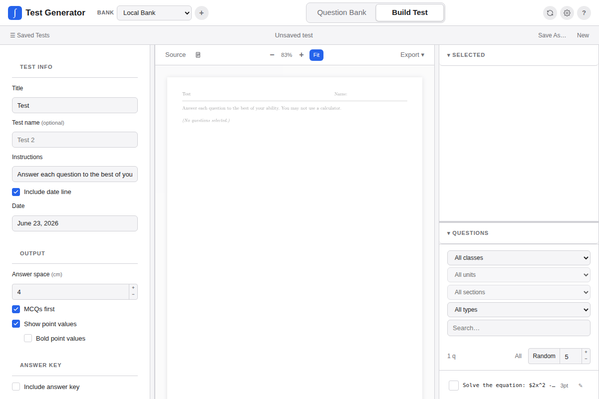

The Test Builder turns selected bank questions into a Typst-backed PDF. It also saves test templates you can reuse later.

## Layout

The Build view has three panels:

- Settings on the left
- PDF preview in the center
- Question picker on the right

The picker's class filter follows the last class viewed in the Bank. It only filters questions; it never changes the test's title.

## Working with Test Tabs

Build opens tests and drafts in a tab strip above the editor. Opening a saved test creates a tab; opening the same test again selects its existing tab. Each unsaved tab keeps its own independent draft, and the open tabs survive a page reload.

- **Alt+T** opens a new blank test tab.
- **Alt+W** closes the current test tab.
- **Alt+Shift+T** restores the most recently closed test tab.

Use **Settings → Test Builder → Workspace** to turn **Open tests in tabs** off. With tabs off, opening or starting a test reuses the single editor as before.

## Saving Tests

The test you're working on saves automatically. A named test is updated in place a moment after each change, and a recovery copy is kept in the browser immediately, so closing the tab or refreshing never loses edits. The status next to the test name shows **Saved locally** once the browser copy is written; a connected folder or sync shows its own status. **Save** (Ctrl/Cmd+S) saves right away. If a save fails, the message has **Retry save**, and your edits stay on screen.

- **Save As…** saves a copy under a new name, with its class, unit and type. You can create a class or unit, or a custom type with **Other…**, in the same dialog.
- **New** opens a new unsaved test tab. With tabs turned off, it replaces the current unsaved test after asking before discarding any content.
- Double-click the test name to rename it.

Saved tests keep the selected questions and their order, layout settings, answer-key settings, point display, bonus flags, curriculum and test type.

The **Saved Tests** library can open a test, edit its details, archive or restore it, delete an archived test, or add it to the Gradebook. Opening an already-open test selects its tab instead of making a duplicate.

## Editing a Question in a Test

Use **+ New question** in the Build question picker to open a blank question in the Editor.
**Save for this test** adds it to your current test. To keep a reusable copy as well, choose
a bank and click **Save to test and bank**. The chooser starts at **Homemade**, which is
created if needed when you save the bank copy.

Use **✎** on any question in the selected-question list to open it in the Editor. The Editor shows only that question, with three choices:

- **Save for this test** keeps the change in this test only. The bank question is not changed.
- **Save in original bank** overwrites the question in the bank it came from, even when that is another bank in a connected workspace folder, and uses the change in this test too. Other saved tests keep their own copies.
- **Cancel** leaves without saving.

A question made in Generate has no bank. It offers **Edit in Generator** instead, which opens its settings in Generate; the questions you make there replace it in the test. If a question's bank original has been deleted, only **Save for this test** is offered.

Changing a question's choices or solution clears any shuffled choice order for it in this test.

## Shared Instructions and Narratives

Questions in a row that share the same instruction or narrative print it once, as one numbered item, with the questions lettered a), b), c) under it. This happens wherever the questions came from and whatever they ask: a passage shared by bank questions, two Generate sections that are both "Evaluate.", or the Easy, Medium, and Hard sections of one outcome. The match is on the text, so the same wording on two unrelated questions counts too. A question on its own, or the same narrative further down the test after something else, starts a new number.

## Questions from Generate

Each section of a Generate worksheet prints as one numbered item: its instruction once, then its questions lettered a), b), c) across the row, like LaTeX's `tasks`. For example:

> **1.** Factor completely.
> a) x² + 3x + 2 &nbsp;&nbsp; b) x² − 9 &nbsp;&nbsp; c) x² − 5x + 6

- **Instruction.** When the questions in a section share their wording, it is stated once as the instruction, and each lettered question keeps only the part that changes. For example:
  - "Solve for $n$: …" becomes "For each equation, solve for $n$."
  - "Write the prime factorization of 4732 using exponents." becomes "Write the prime factorization of each number using exponents.", with a) 4732.
  - "Find the slope of the line." above a different graph becomes "Find the slope of each line.", with each letter showing its graph.

  Questions with nothing in common, such as word problems, stay whole under "Answer each question." Edit the instruction in the box at the top of the section in Generate.
- **Columns.** Auto fits short items four to a row and long items one to a row. Multiple-choice options and drawings get more room. Choose 1 to 4 to set it yourself. When sections with the same instruction continue one item, each column setting gets its own rows and the letters carry on.
- **Continuing sections.** In Generate, a section with the same instruction as the one above shows the same number with a dashed border and "Continues 2". Its letters carry on from the section above. Give it a different instruction to make it its own item.
- **Numbering.** Build's list and the answer key use the printed labels, such as 2b. With **MCQs first**, a whole multiple-choice section moves together. A section with one question prints as an ordinary numbered question.
- **Points** print once for the item, as the section's total. Each question keeps its own answer space.

Questions made in Generate after you edit or replace one keep their place in the lettered item.

## Test Type

Saved tests can be labeled as:

- Quiz
- Test
- Assignment
- Exam
- Formative
- Worksheet
- Other

The Gradebook uses this type for category grouping and course-section weights.

## Bonus Questions

In the selected-question list, use the bonus control to mark a question as bonus. Bonus questions keep their own point value and are labeled in the generated Typst/PDF output. In Gradebook snapshots, bonus points are kept separate from the base denominator.

## Adding a Saved Test to Gradebook

In the Saved Tests panel, use the add-to-gradebook action on a saved test. This creates a Gradebook assessment snapshot. Later edits to the saved test or question point values do not change old grades.

If the saved test type/category changes later, matching Gradebook assessments update that category for totals. The frozen question order and point values stay the same.

## Settings

### Test Info

| Setting | Description |
|---|---|
| Title | Appears centered at the top. |
| Test name | Optional second line below the title. |
| Instructions | Shown below the name line in italics. |
| Date | Include a date line, and optionally fill in the date. |

### Output

| Setting | Description |
|---|---|
| Answer space | Blank vertical space below each question, in centimeters. Each question in the selected list can override it. |
| First question number | The number of the first question, for a test that continues another, such as part 2 starting at 21. |
| MCQs first | Places multiple-choice questions before free-response questions. |
| Show point values | Point labels next to question numbers. **Bold point values** makes them bold. |
| Show points total | Prints the test's total points. **Place it** puts it **On the title line**, **Under the instructions**, or **At the end of the test**. **Wording** sets the text, with `{total}` for the number (default "Total: {total} points"). |

### Answer Key

| Setting | Description |
|---|---|
| Include answer key | Appends an answer key headed with the class and test name. |
| Answer key columns | Choose one or two columns for the key and solutions. Applies to Answer Key PDF and Test + Answer Key PDF. The answer-strip page keeps its original alignment. |
| Keep each solution together | Moves a solution to the next page or column instead of splitting it. Solutions taller than a full column can still split so their content stays visible. |
| Include full MCQ solutions | Includes MCQ explanations in the verbose solution section. |

### Formatting

| Setting | Description |
|---|---|
| Font size | Body text size: 10, 11, or 12 pt. |
| Paper | US Letter, US Legal, US Ledger / Tabloid, A3, A4, A5, B4 or B5. |
| MCQ choice columns | **Auto** fits as many choices per row as possible without wrapping. Choose 1–5 to set a target for this test. Text can wrap to reach that target, and wide choices can use fewer columns. |
| Page numbers | None, or a page number at the bottom inside, centre or outside. Inside and outside alternate for double-sided printing: outside is on the right of odd pages and the left of even pages; inside is the reverse. |
| Margin | Page margin in inches. |
| Edit preamble manually… | Opens the raw Typst preamble for editing. This bypasses the form controls; **Reset** restores the automatic preamble. |

Defaults for new tests are set in **Settings → Test Builder Defaults**.

### Graph Defaults

Graph defaults configure `simple-plot` graphs written in question source (see [Typst Authoring](./typst-authoring.md)): grid color, axis weight, curve weight, asymptote color, width, height, and x and y tick steps. They don't change pictures, such as Math Graph drawings.

## Selecting Questions

The picker on the right has **Browse** and **Selected** tabs. Each tab uses the full panel height and keeps its scroll position when you switch. The question count and total points remain visible above both tabs. Adding a question keeps you in Browse. Use the outward-arrow button beside the picker tabs to open a larger card for browsing and ordering. The inward-arrow button returns to the preview and restores the previous panel layout. On small screens, **Show questions** opens the picker using the full available space.

In **Browse**, search and choose banks and classes from their menus. Check as many as you like, or use **only** beside one to pick just that one. The menu button names your choice, such as "Algebra 1 +1", and each option shows how many questions match the other filters. With nothing checked, the menu includes everything. Choosing a class in the Bank switches Build to that class.

Choose **All types**, **MCQ**, or **FRQ** beside **Filters**. Open **Filters** to choose units, sections, a curricular outcome, or tags. Type part of a code or name, such as `exp`, in the search box above **Sections** or **Curricular outcomes** to narrow those options. Checking several units or sections includes questions from any checked option in that group. Different groups combine to narrow the results. Tags can match **all** or **any** checked tags. Changing a class or unit clears section choices that no longer apply.

Filters chosen in the panel appear as removable chips. **Clear filters** resets all choices, search, classes, and banks. In a [local workspace](./local-workspace.md), the bank menu searches **All workspace banks**, or any mix of the **Active bank** and the workspace's banks. Questions whose last render check failed aren't offered.

Use **Used on tests** to hide questions that already appear elsewhere. **Any other active test** checks all current Saved Tests and Test Generator assessments in active Gradebook sections. **Specific tests or groups** lets you combine classes, Gradebook sections, saved tests, and individual Gradebook assessments; class and section choices include all of their listed tests. The test currently open in Build and its Gradebook copies are ignored, archived history and external assessments are not included, and this filter never removes questions already selected for the test.

- Check a question to add it; uncheck it to remove it.
- **All** adds every matching question, across all pages.
- **Random** adds the number of randomly chosen matching questions set in the count box.

The **Selected** tab shows the order and the test's total points. Drag the handle to reorder. Each question has a remove button (**✕**), an answer-space override, a bonus control, and, for multiple choice, **⟳** to shuffle its choices. **Shuffle MCQ** shuffles every multiple-choice question. **Shuffle order** puts the questions in a random order; the lettered questions of a generated section stay together as one item. **Clear all** empties the test.

You can also add questions from the Question Bank or the Editor: check them and choose **Add to…** → **Current test** or **New test**. See [Adding Questions to a Test](./question-bank.md#adding-questions-to-a-test).

## Preview and Export

The preview pane compiles the current test with the Typst WebAssembly compiler and displays it inline. The first compile on a fresh page load downloads the Typst engine, which the browser caches.

The preview toolbar has zoom (**−**, **+**, reset to 100%, and **Fit** to width) and a print-preview toggle that shows the test black on white regardless of the app theme.

The **Print** button opens a print sheet. Choose the student test, the answer key,
the test followed by its answer key, or a complete **Class set**. For a class set:

- Choose an active Gradebook class to use its current student count, or enter a
  custom number of papers. Use the **−** and **+** controls beside **Student
  papers** to account for absences or make extra copies; the roster itself is not
  changed.
- Choose how many MCQ versions to make. Version A keeps the choice order shown in
  Build. Version B and later deterministically scramble the choices. TestGen
  remembers the last MCQ version count and custom paper count in this browser.
- Turn **Print version label on student papers** on or off. This only controls the
  Version A/B label on tests; answer lists in the key always identify their version.
  TestGen remembers this choice and the alternating/grouped paper order for the
  next print job.
- Choose **Alternate versions** for A, B, A, B… or **Group by version** for all A
  papers followed by all B papers, and so on.
- Use **Include answer key** and **Include answer strip page** to choose what
  follows the student papers. The combined key contains a labeled MCQ list for
  each version and one copy of the written solutions. All version strips share
  one page. The print sheet starts with the strip setting from Build. Changes
  here apply to the print job.
- Print **one copy** in the browser dialog because the PDF already contains
  every student paper.

For **Test + answer key** and **Class set**, the print sheet warns if a student
copy has an odd number of pages, excluding the key and answer strip. Turn on
the blank-page option to start the key or the next student copy on a fresh
sheet when printing double-sided. Blank pages may count toward your printing
allowance. To avoid adding them, print **Student test** separately, enter the
number of copies in the browser’s print dialog, and print the **Answer key**
separately. The **Student test** option repeats the version shown in Build.

The sheet confirms the version distribution, paper, orientation, page count and
readiness before opening the browser print dialog. The browser controls duplex
printing, colour, scaling and printer trays. In Build, **Ctrl/Cmd+P** opens this
print sheet instead of printing the application screen.

The **Export** menu has:

- **Test PDF** (no answer key)
- **Answer Key PDF**
- **Test + Answer Key PDF** in one file
- **Everything (.zip)**: test PDF, answer key PDF and Typst source

Downloaded files are named from the title and test name, for example `AP Calculus - Test 1.pdf` and `AP Calculus - Test 1 - Answer Key.pdf`.
- **Typst Source (.typ)**, to open in any Typst installation

If the test fails to compile, **Show Typst source** shows the source so the error can be found.
